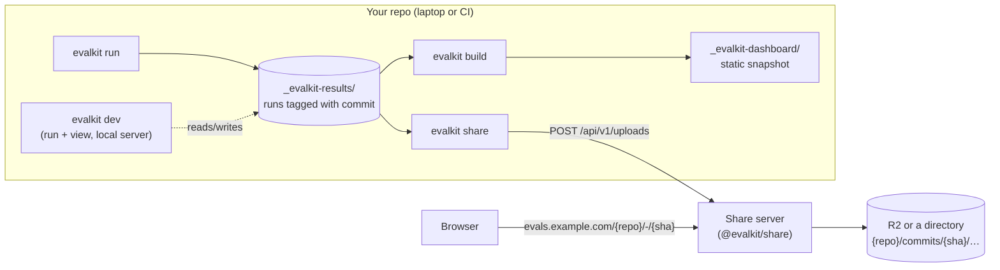
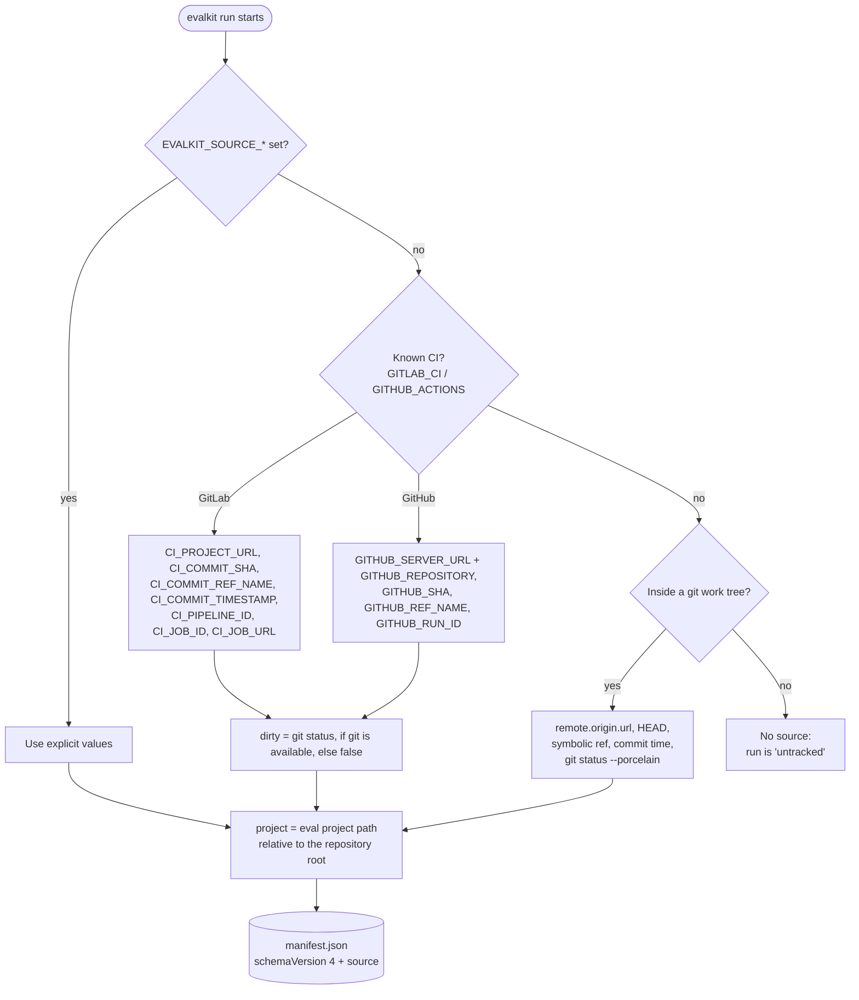
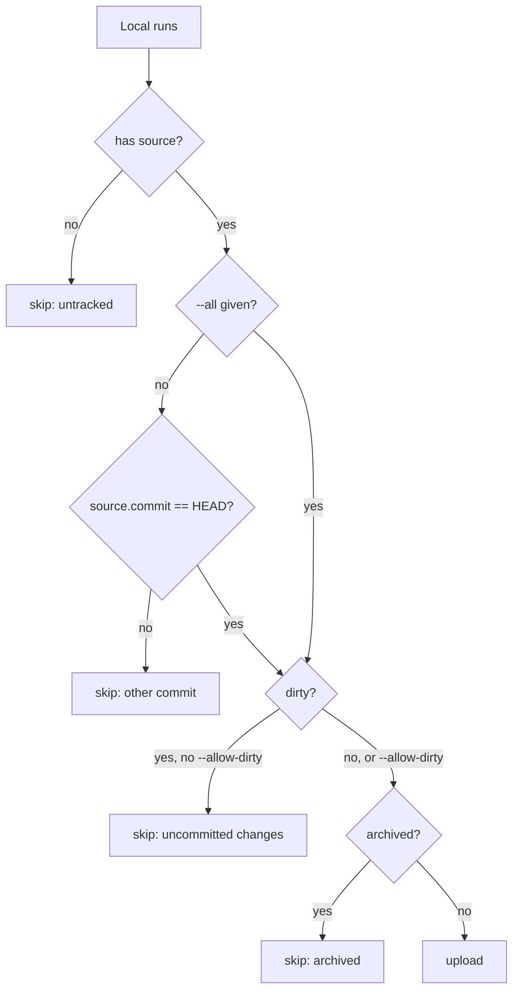
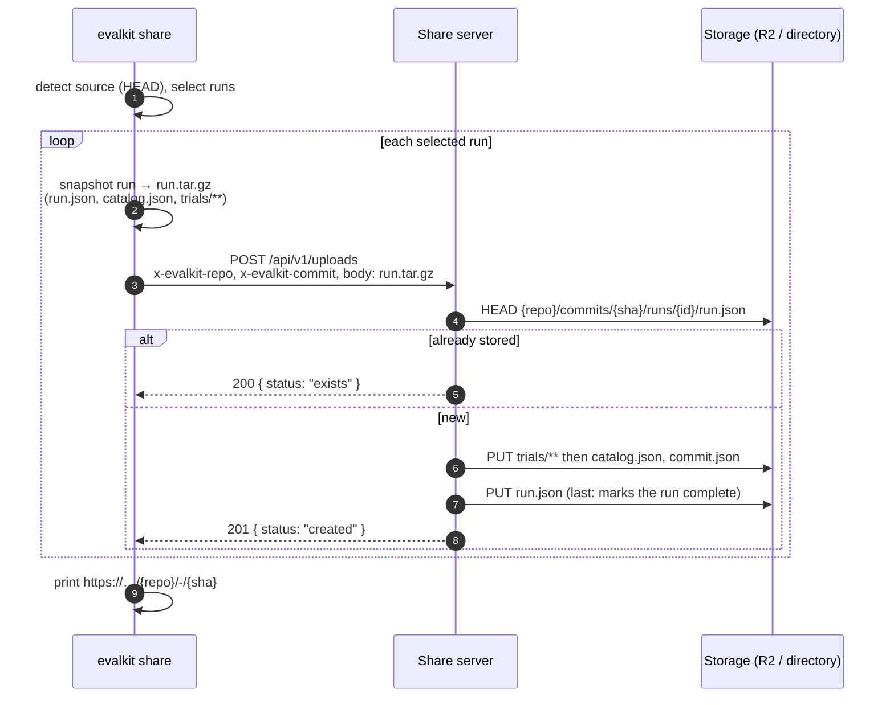
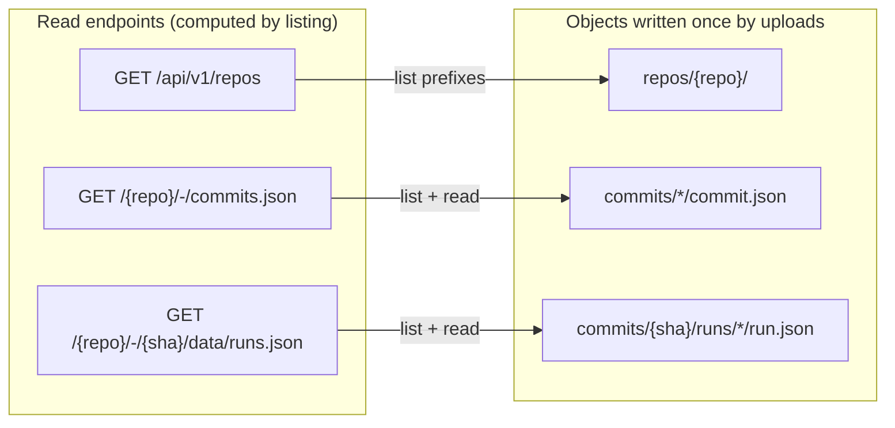
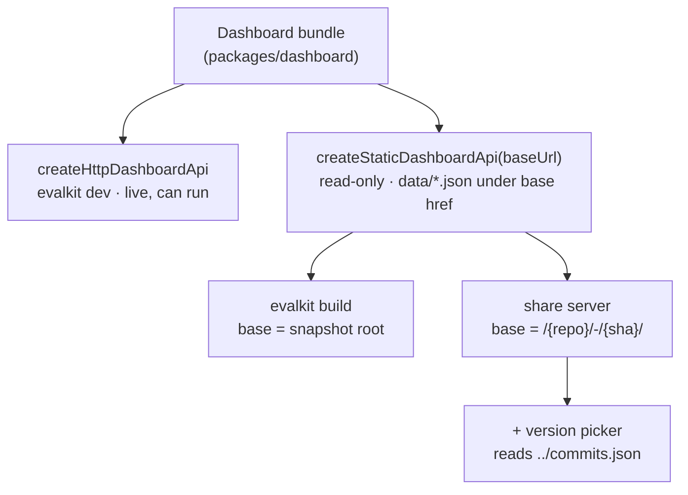
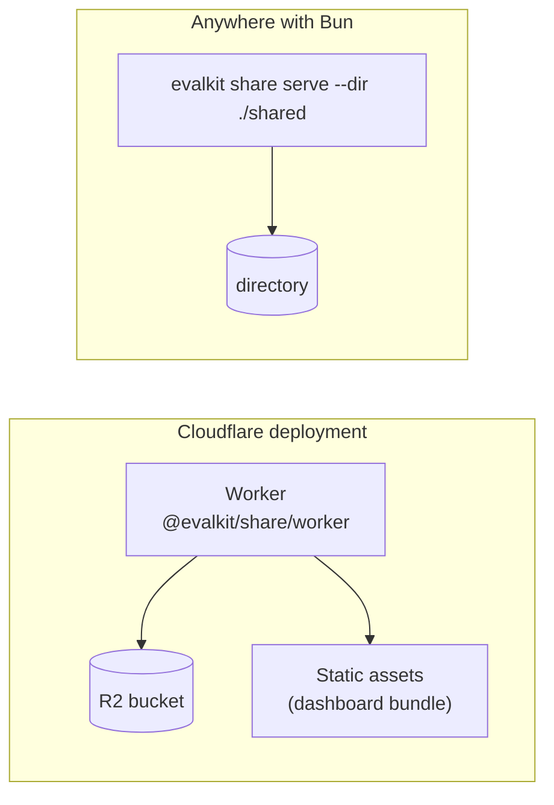
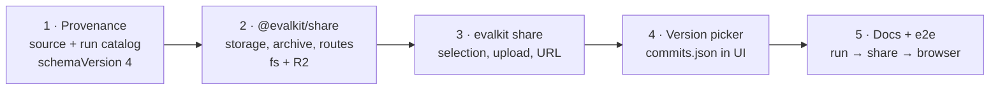

# RFD0006 - Commit Provenance and Share Server

- Feature Name: `commit-provenance-and-share-server`
- Status: Draft
- Author: `leostera`
- Start Date: `2026-10-28`
- Updated: `2026-10-28`
- Discussion PR: `TBD`
- Tracking Issue: `TBD`

## Summary

Evals are code in your repository, so their results belong to a commit. This RFD makes every run record its **source** (repository, eval project path, commit, ref, dirty flag, CI job). It also adds `evalkit share`, which uploads a commit's results to a self-hosted **share server**, a new `@evalkit/share` package. The share server is the existing read-only dashboard turned into a service: it stores the data `evalkit build` already produces in R2, keyed by repository and commit, and serves it with the same UI at `https://evals.example.com/<repo>/-/<commit>`. The server runs on a private network and has no authentication. Remote execution ([RFD0002](RFD0002-deployable-cloud-runner.md)) remains future work. This RFD only covers where results go and how to find them.

## Motivation

- **Results have no version today.** `_evalkit-results/<run>/manifest.json` records the eval, parameters and agent, but not the code that produced them. After a few commits there is no way to tell which runs reflect the current evals.
- **CI produces results on every commit.** A GitLab CI component (built elsewhere) runs `evalkit run` per commit. Its artifacts need a home where people can browse them by commit.
- **Snapshots are single-use.** `evalkit build` writes one static dashboard for one set of results. Sharing history means hosting many snapshots and choosing between them.
- **We already have most of it.** The snapshot data format, the static `DashboardApi`, path-based routing with `<base href>`, and the run/trial UI all exist. The missing pieces are the commit key, an upload, and a server that maps URLs to stored snapshots.

## Goals

- Record source provenance in every new run, from CI variables or git, with no configuration.
- `evalkit share` uploads results for a commit, shows progress, and prints the URL.
- `@evalkit/share` deploys as a Cloudflare Worker with one R2 bucket, or runs with Bun on a local directory.
- One dashboard bundle and one `DashboardApi` implementation serve `build` snapshots and share-server commits.
- Retrying uploads is safe, and concurrent uploads for the same commit never lose data.
- A version picker switches between commits of a repository.

## Non-goals

- Authentication, authorization, or multi-tenancy. The server sits on a private network.
- Remote execution (`evalkit run --remote`). See [RFD0002](RFD0002-deployable-cloud-runner.md).
- Comparing results across commits, trends, or flaky-eval detection. The layout must allow them later.
- A GitLab CI template.
- Deleting or expiring shared results.

## Guide-level explanation

### The workflow



| Command             | What it does                                                                   |
| ------------------- | ------------------------------------------------------------------------------ |
| `evalkit run`       | Runs evals and writes local results, now tagged with the commit.               |
| `evalkit dev`       | Local dashboard: browse results and start runs.                                |
| `evalkit build`     | Writes a static snapshot to a directory.                                       |
| **`evalkit share`** | Uploads results for the current commit to the share server and prints the URL. |

### Configure once

```ts
// evalkit.config.ts
export default defineConfig({
  share: { url: 'https://evals.example.com' },
});
```

`EVALKIT_SHARE_URL` overrides it (useful in CI).

### Share

```
$ evalkit run
$ evalkit share

  EvalKit share v0.4.0

  ✓ Eval project         3 evals loaded 4ms
  ✓ Source               gitlab.example.com/team/agent-evals @ 3a01fda (main) 12ms
  ✓ Snapshot             4 runs · 40 trials · 12 candidate files 85ms
  ◇ Uploading            run 3/4 · 1.4 MB
  ✓ Uploaded             3 new · 1 already shared 1.20s

  ➜  https://evals.example.com/gitlab.example.com/team/agent-evals/-/3a01fda7c2e4…
```

### Browse

```
https://evals.example.com/
  └─ gitlab.example.com/team/agent-evals          → latest commit
       ├─ /-/main                                              → latest commit on main
       ├─ /-/3a01fda                                           → full SHA (redirect)
       └─ /-/3a01fda7c2e4…/                                    → that commit's dashboard
            ├─ suites, agents, fixtures                        (evals as of that commit)
            ├─ runs, runs/<run-id>
            └─ trials/<trial-id>, workspaces/<trial-id>
```

The dashboard header gets a **version picker** listing the repository's commits (newest first, with ref, time and pass rate). Picking one moves to `/<repo>/-/<sha>/…` and keeps the current page when it exists.

## Reference-level explanation

### 1. Source provenance

#### Detection order



#### Manifest

```jsonc
// _evalkit-results/<run-id>/manifest.json
{
  "schemaVersion": 4,
  "runId": "…",
  "evalId": "greeting",
  // … existing fields unchanged …
  "source": {
    "repo": "gitlab.example.com/team/agent-evals",
    "project": "evals", // "" when the eval project is the repo root
    "commit": "3a01fda7c2e4…", // full 40-character SHA
    "ref": "main", // optional
    "committedAt": "2026-10-28T18:44:46Z", // optional, used to order versions
    "dirty": false,
    "ci": { "provider": "gitlab", "pipeline": "123", "job": "456", "url": "…" }, // optional
  },
}
```

- **Repository key normalization:** `git@host:group/repo.git`, `https://user@host/group/repo.git` and `ssh://host/group/repo` all become `host/group/repo`. That means lowercase host, no credentials, no `.git`, and no trailing slash.
- **Compatibility:** readers accept schema versions 2, 3 and 4. `source` is optional, so runs without it are **untracked**. They still work in `dev` and `build`, but `share` refuses them.
- **Run catalog:** `evalkit run` also writes `catalog.json` beside the manifest: the evals, suites and catalog entries at run time. A commit's eval list therefore comes from the runs themselves, not from whatever code is checked out when sharing.

```
_evalkit-results/<run-id>/
├── manifest.json          (+ source)
├── catalog.json           NEW: { evals, suites, catalog } at run time
├── summary.json
└── trials/<trial-id>/…    unchanged
```

### 2. `evalkit share`

#### Selection



- Skipped runs are counted in the output, for example `2 untracked · 1 dirty skipped`.
- If nothing is selected, the command exits with an error and explains why, for example "No runs for HEAD 3a01fda; run `evalkit run` first".

#### Upload protocol

The CLI reuses the snapshot writer from `evalkit build`. It packs each run's snapshot data into its own gzip-compressed tar and uploads runs one at a time. That gives progress per run, keeps request bodies well under Worker limits, and lets a failed upload be retried by itself.



- **Validation on the server:** the server checks every archive entry. It rejects absolute paths, `..`, non-regular files and unknown top-level names, and it checks that the run's `source` matches the headers.
- **Write ordering:** `run.json` is written last, so a crash mid-upload leaves no visible half-run. A retry overwrites the partial files.

### 3. Storage layout

No file is ever read, changed and written back. Every object is written once by the upload that owns it, and indexes are computed by **listing** objects. That's why concurrent CI jobs for the same commit cannot lose each other's runs.

```
<bucket or directory>/
└── repos/
    └── gitlab.example.com/team/agent-evals/   ← repo key (+ "/~<project>" when not root)
        └── commits/
            └── 3a01fda7c2e4…/
                ├── commit.json        { commit, ref, committedAt, repo, project }  (same content from every upload)
                ├── catalog.json       commit catalog (from a non-dirty run)
                └── runs/
                    └── 9c67c094-…/
                        ├── run.json            dashboard RunSummary + source  (written last)
                        ├── catalog.json        this run's catalog
                        └── trials/<trial-id>/
                            ├── detail.json  events.json  artifacts.json  workspace.json
                            └── workspace/**   candidate files (never evaluator files)
```



- **Computed indexes:** read endpoints may cache them, for example with the Cache API on Workers. Correctness never depends on the cache.
- **Pass rates:** the commit pass rate shown in the version picker comes from the listed `run.json` files.

### 4. Share server

#### Routes

| Method & path                             | Response                                                                                        |
| ----------------------------------------- | ----------------------------------------------------------------------------------------------- |
| `POST /api/v1/uploads`                    | Store one run archive. `201 created` or `200 exists`; `400` for an invalid archive.             |
| `GET /api/v1/repos`                       | Known repositories (JSON). `GET /` renders them as a list.                                      |
| `GET /<repo>`                             | `302` → latest commit by `committedAt`.                                                         |
| `GET /<repo>/-/commits.json`              | Commits, newest first: `{ commit, ref, committedAt, runs, passed, failed }`.                    |
| `GET /<repo>/-/<ref-or-short-sha>/<rest>` | `302` → `/<repo>/-/<full-sha>/<rest>`: the latest commit for a ref, or a unique SHA prefix ≥ 7. |
| `GET /<repo>/-/<sha>/data/runs.json`      | Computed from listed `run.json` files.                                                          |
| `GET /<repo>/-/<sha>/data/<path>`         | The stored object (catalog, trials, events, workspace files).                                   |
| `GET /<repo>/-/<sha>/<anything else>`     | Dashboard `index.html` with `<base href="/<repo>/-/<sha>/">`.                                   |
| `GET /_evalkit/assets/*`                  | Dashboard JS/CSS (shared by all repos; long-lived cache).                                       |

`/-/` separates the repository path, which may contain nested groups, from the commit, as in GitLab URLs.

#### One dashboard, three hosts



The share server serves the same URL shape as a snapshot, with data under `<base href>/data/…`, so `createStaticDashboardApi` works unchanged. The only UI change is the version picker. It appears when `commits.json` exists next to the base, and it can later read local commits in `dev` and `build`.

#### Package

```
packages/share/
├── src/app.ts        createShareApp({ storage, assets }) → Hono app (all routes above)
├── src/storage.ts    Storage interface: get, put, head, list(prefix, delimiter)
├── src/r2.ts         R2 storage
├── src/fs.ts         directory storage (Bun/Node; used by tests and `evalkit share serve`)
├── src/archive.ts    streaming tar.gz reader with path validation
├── src/worker.ts     Worker entry: storage = env.RESULTS (R2), assets = env.ASSETS
└── wrangler.jsonc    template: R2 binding + static assets from the bundled dashboard
```



- **Distribution:** shipped inside `@leostera/evalkit` as the `@leostera/evalkit/share` and `@leostera/evalkit/share/worker` exports, alongside the dashboard assets already in the package.
- **Deploying:** a project deploys with a three-line Worker entry and the template `wrangler.jsonc`.
- **Without Cloudflare:** `evalkit share serve` runs the same app on a directory.

### 5. Invariants

1. A shared run is immutable. Re-uploading it is a no-op, and the server never changes stored runs.
2. A run is visible only once its `run.json` exists.
3. No read-modify-write on shared objects. Indexes are computed from listings.
4. Uploads never include evaluator workspaces or files outside the snapshot format, and the server rejects archive paths that escape their run.
5. Dirty runs are never uploaded without `--allow-dirty`, and they are always labelled in the UI and excluded from a commit's pass rate.
6. The dashboard bundle and the static API are shared by `build` and the share server, with no separate share UI.

### 6. Failure behaviour

| Situation                             | Behaviour                                                                            |
| ------------------------------------- | ------------------------------------------------------------------------------------ |
| No `share.url` / `EVALKIT_SHARE_URL`  | Error naming both, before any work.                                                  |
| Not a git repo and no CI/env source   | Error: `share` needs commit provenance; `build` still works.                         |
| Server unreachable / 5xx              | Retry each run upload with backoff (3 attempts); report runs that failed; exit 1.    |
| Some runs uploaded, then failure      | Already-uploaded runs stay; rerunning `share` skips them (`exists`).                 |
| Archive rejected (`400`)              | Print the server's reason; exit 1. Indicates a CLI/server version mismatch or a bug. |
| Snapshot format newer than the server | `400 unsupported format N`; upgrade the server.                                      |

## Rollout



**Acceptance:**

- A run in a git repository, or in CI with GitLab variables, records the expected `source`, and a dirty tree sets `dirty: true`.
- `evalkit share` against `evalkit share serve --dir` prints a URL. Opening it in a browser shows the commit's evals and runs, and deep links reload.
- Two concurrent `share` processes for the same commit store both sets of runs.
- Re-running `share` reports `already shared` and uploads nothing.
- The Worker build works in `wrangler dev` with a local R2 binding.

## Drawbacks

- **The snapshot JSON becomes a storage format.** Shared commits stay in R2 for a long time, so the dashboard must keep reading old formats. Mitigation: the archive records a format version, and the static API keeps readers for older versions.
- **Listing on every read.** Computing `runs.json` and `commits.json` by listing is simple and avoids races, but it gets slower for commits with thousands of runs or repos with thousands of commits. Caching, then a D1 projection, can be added without changing the stored layout.
- **No auth.** This is safe only on a private network. Anyone who can reach the server can upload.
- **Run catalogs add a small file to every run.**

## Alternatives

- **Do nothing; upload `_evalkit-dashboard/` snapshots to a bucket by hand.** This works for one-off sharing, but you get no history, no version picker, and no safe concurrent uploads.
- **Upload raw `_evalkit-results` trees and render on the server.** This keeps one source format, but the server would need the Node report reader and file-system semantics in a Worker. Converting on the client reuses the tested `build` code.
- **Keep a git repository of results (Cloudflare Artifacts) that mirrors the source repo.** It's good for browsing and diffs, but poor for "list commits, list runs, pass rates". R2 prefixes fit those queries better.
- **Keep a per-commit `runs.json` index updated on each upload.** It's faster to read, but concurrent CI jobs would race. That needs a Durable Object or D1 to coordinate, which adds complexity before it's needed.
- **Fold sharing into RFD0002's runner.** This couples sharing to remote execution. Sharing is useful on its own, and the runner can later write into the same layout.

## Unresolved questions

Before acceptance:

1. **Monorepos with several eval projects:** the proposal appends `/~<project>` to the repository key (`…/agent-evals/~evals/-/<sha>`). The alternative is one dashboard per repo with a project filter.
2. **Should `share` upload all runs for HEAD, or only the runs of the latest `evalkit run` invocation?** The proposal: all runs for HEAD.

During implementation:

3. **Order of commits that lack `committedAt`:** probably by first upload time, recorded in `commit.json`.
4. **Version picker behaviour when the current page doesn't exist at the other commit**, for example a run ID: fall back to that commit's runs list.

## Future possibilities

- **Remote execution:** `evalkit run --remote` ([RFD0002](RFD0002-deployable-cloud-runner.md)) writing into this storage layout directly.
- **Comparing commits:** a pass/fail and score diff per eval between two commits (`/<repo>/-/compare/<a>...<b>`).
- **Per-eval fingerprints:** to tell when an eval did not change between commits, so results can be compared or reused.
- **Querying across commits:** a D1 projection for trends, flaky evals, and "latest result per eval".
- **A version picker for local results:** in `dev` and `build`, using the same `source` data.
