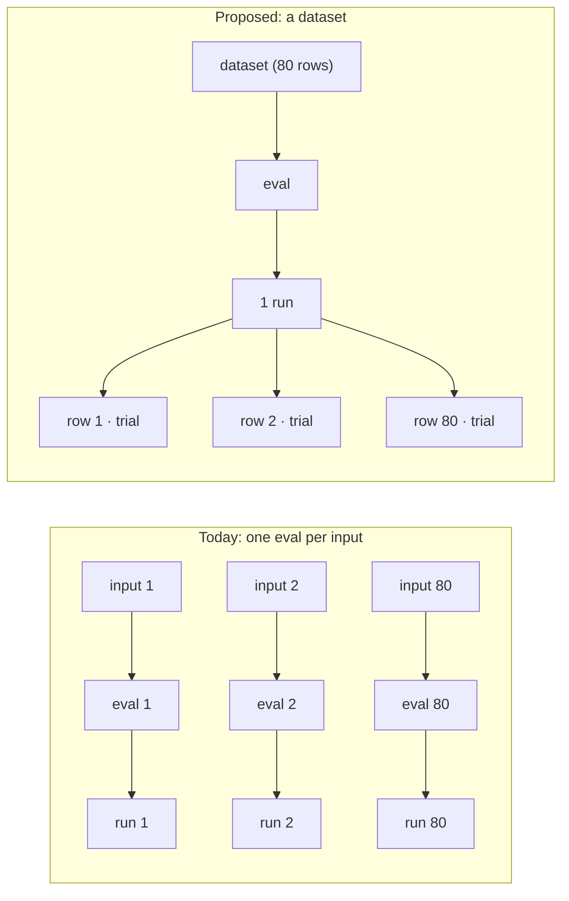
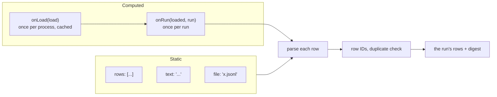
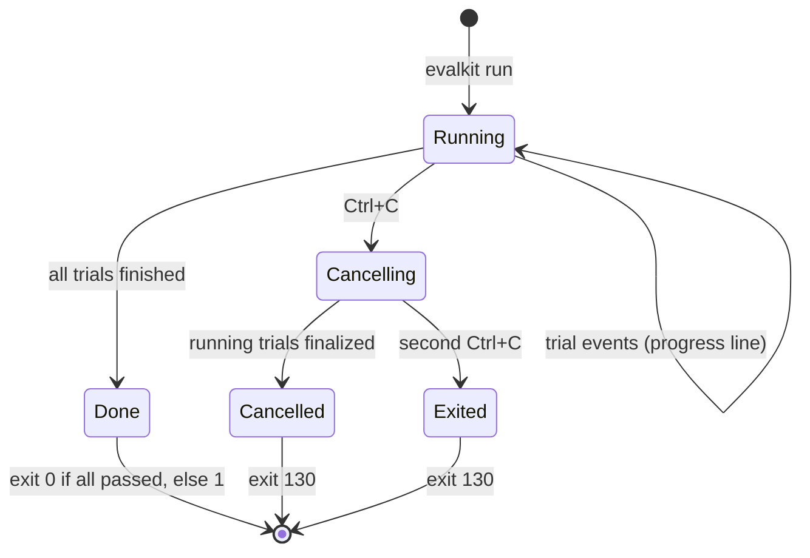
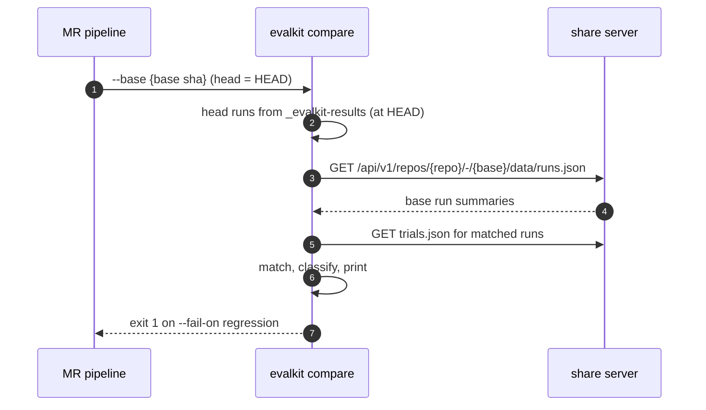
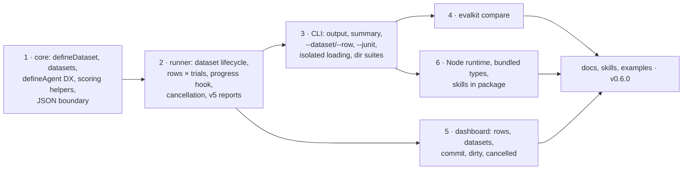

# RFD0007 - Datasets, Authoring Ergonomics, and CI Reporting

- Feature Name: `datasets-authoring-and-ci-reporting`
- Status: Draft
- Author: `leostera`
- Start Date: `2026-10-30`
- Updated: `2026-10-30`
- Discussion PR: `TBD`
- Tracking Issue: `TBD`

## Summary

Many evals are a list of inputs run through the same agent and graded by the same scorers. EvalKit has no word for that list, so authors write one eval per input and glue code around it. This RFD improves the authoring experience around that shape, and around running evals in CI:

- **Datasets:** `defineDataset({ ... })`, by convention in `./datasets/`, declares rows. A dataset can be fully static (rows, inline text or a file), or computed: `onLoad` builds it once per process and caches it, and `onRun` derives each run's rows from that, using the run's configuration. An eval runs over one or more datasets with `datasets: [...]`, and each row becomes trials inside **one** run.
- **A better `defineAgent`:** lifecycle events become optional, `send()` can return the turn's reply and tool calls instead of emitting events, `close()` and `runtimes` get defaults, and agents can see the current row.
- **Scoring helpers:** the final output on the scoring context, pass thresholds for 0–1 scores, and a real "not applicable" result.
- **JSON at the boundary:** events, metadata and rows accept plain values and are converted once, with errors that name the bad field.
- **Isolated loading:** one eval file that fails to load no longer breaks every command.
- **Suites from directories:** `evals/chat/*.eval.ts` is suite `chat`, with no hand-written registry.
- **CI reporting:** live progress, a final summary, quieter result lines, JUnit output, and clean Ctrl+C cancellation.
- **`evalkit compare`:** compares a commit's results with a base commit's, for merge request gates and comments.

It also covers three release items that need no design: running the CLI on Node, readable published types, and shipping the skills in the npm package. Report schema version 5 records datasets, rows, cancellation and skipped scores. Readers keep accepting versions 2 to 4.

## Motivation

Writing a suite of the form "these inputs, this agent, these scorers" today takes more code than the eval itself:

- **One eval per input.** There is no dataset, so authors generate an eval per row, pass the row's identity through `metadata`, and look the row up again inside the agent. Every row becomes its own run: a suite of 80 inputs is 80 runs in the dashboard, and large suites need a higher `maxCells`.
- **Adapters full of bookkeeping.** The documented adapter emits `started`, `turn-started`, `message`, `turn-completed` and `completed` around what is often a single function call. Authors copy that pattern even though the runner does not need most of it.
- **Scorer glue.** Scorers search the trajectory for the final assistant message, wrap every 0–1 score in a pass threshold, and fake "not applicable" as a pass with custom evidence.
- **Casting to JSON.** `JSON.parse(JSON.stringify(x)) as JsonValue` shows up wherever events, metadata or evidence carry ordinary objects.
- **One module breaks everything.** An eval module that checks credentials when it is imported stops every command, even `--dry-run` and `build`, for every eval in the project.
- **A registry only for grouping.** Projects write an explicit registry just to put evals into suites.
- **CI logs that are hard to read.** Result lines end in `{}` when there are no parameters, score lines repeat themselves (`predicate Correctness: 0.5 Correctness scored 0.5 (passes at 0.5)`), there is no final count, and CI gets no test report.
- **No baseline comparison.** Teams want a merge request to show what got better or worse than the target branch, and to fail on regressions. EvalKit cannot do that yet.



## Goals

- Datasets are values with an identity, defined once and shared by any number of evals. An eval can run over several datasets.
- Expensive datasets are built once per process; per-run variations do not rebuild them.
- Each row gets its own isolated trial (or trials), and the run reports per-row results.
- Row IDs are stable across edits to other rows, so results can be compared between commits.
- Writing an agent with `defineAgent` needs no event bookkeeping for simple agents, and stays fully general.
- Scorers read the final output directly, can declare a pass threshold, and can report "not applicable".
- A failing eval module affects only the evals it defines.
- Suites need no registry when evals are organized in directories.
- CI output is short, has a summary, and can produce JUnit. Ctrl+C leaves no run looking "running" forever.
- `evalkit compare` reports regressions and fixes between two commits and can gate a pipeline.
- The CLI runs on Node 22 as well as Bun.

## Non-goals

- New agent kinds. Teams define their own agents with `defineAgent`; this RFD makes that easier instead of adding prepackaged adapters.
- Compatibility layers for other eval frameworks. Porting should be direct because the shapes now exist.
- Remote dataset storage or versioning. A dataset is code, a file in the repository, or a function. Runs record a digest of the rows they used.
- Replacing fixtures. A fixture is files materialized into a trial's workspace; a dataset is the inputs an eval iterates over. A row can still bring its own fixtures.
- Statistical significance in comparisons. `compare` reports per-row and per-scorer changes and counts; confidence intervals stay future work (RFD0005).
- Changing matrices. Matrix `cases` (RFD0005) and dataset rows are different things: a matrix varies the **configuration**, a dataset varies the **input**. They compose.

## Guide-level explanation

### A dataset eval

```text
my-evals/
├── agents/support-bot.ts
├── datasets/
│   ├── faq.dataset.ts
│   └── escalations.jsonl        one JSON row per line
├── evals/support/answers.eval.ts
└── judges/
```

```ts
// datasets/faq.dataset.ts
import { defineDataset } from '@leostera/evalkit';

export default defineDataset({
  id: 'faq',
  name: 'Product FAQ',
  rows: [
    {
      id: 'reset-password',
      input: 'How do I reset my password?',
      expected: 'Settings → Security → Reset',
    },
    {
      id: 'export-data',
      input: 'Can I export my data?',
      expected: 'Yes, as CSV from Settings → Data',
    },
  ],
});
```

```ts
// evals/support/answers.eval.ts
import { defineDataset, defineEval, predicate, user } from '@leostera/evalkit';
import { supportBot } from '../../agents/support-bot.ts';
import faq from '../../datasets/faq.dataset.ts';
import { judgeAnswer } from '../../judges/answer.ts';

const escalations = defineDataset({ file: 'datasets/escalations.jsonl' }); // id: "escalations"

export default defineEval({
  id: 'answers',
  agent: supportBot,
  datasets: [faq, escalations],
  transcript: (row) => [user(row.input)],
  scoring: (row) => [
    predicate('correct', ({ output }) => judgeAnswer(output, row.expected), {
      passAt: 0.5,
    }),
  ],
});
```

A scorer that does not apply to a row returns `skip('reason')`.

### Datasets that are built, not written

Some datasets are expensive to build (fetched from a service, generated by a script) or depend on the run's configuration. `onLoad` builds the expensive part once per process and caches it. `onRun` turns it into each run's rows, given the run's parameters:

```ts
export default defineDataset({
  id: 'tickets',
  // Once per process: every eval, matrix cell and dashboard launch reuses it.
  onLoad: async ({ root, signal }) =>
    fetchRecentTickets({ since: '30d', signal }),
  // Once per run: pick the rows for this cell's language.
  onRun: (tickets, { parameters }) =>
    tickets.filter((ticket) => ticket.language === parameters.language),
});
```

### An agent

`defineAgent` stays the one way to define an agent. For a request/response agent, `send` returns the turn's result and EvalKit records the events:

```ts
// agents/support-bot.ts
import { defineAgent } from '@leostera/evalkit';

export const supportBot = defineAgent({
  identity: { kind: 'http', id: 'support-bot', name: 'Support bot' },
  async start({ context }) {
    const conversation = await openConversation();
    return {
      async send(message) {
        const reply = await conversation.ask(message);
        return {
          reply: reply.text,
          toolCalls: reply.toolCalls,
          usage: reply.usage,
        };
      },
    };
  },
});
```

Agents that stream can keep calling `onEvent` as they do today; the two styles mix.

### Running and reading results

```sh
bun run evalkit run --suite support
```

```text
  EvalKit run v0.6.0

  Running 3 evals · 57 rows from suite support at 1a2b3c4 (main)

  ✓ greeting               5/5 rows   0.4s
  ✗ answers               16/18 rows  41.2s
      ✗ faq/export-data          correct 0.0 (passes at 0.5)
      ✗ escalations/r-4f1a90c2   correct 0.0 (passes at 0.5) · tone skipped
  ◇ handoff                3/34 rows · row 4 · tool lookupOrder · 12s

  …

  55 passed · 2 failed · 57 rows in 3m12s
  ➜ bun run evalkit dev        to inspect
  ➜ bun run evalkit share      to publish
```

- One line per eval, then one indented line per failing row with its failing scores. `--verbose` prints every score.
- The `◇` line is the live status of running evals on a terminal. In CI it is replaced by one line when each eval starts and finishes.
- `--dataset <id>` and `--row <dataset>/<row>` run only part of an eval, for debugging one case.
- `--junit <file>` also writes a JUnit XML report (suites as test suites, rows as test cases).
- Ctrl+C stops starting new trials and finalizes the running ones as **cancelled**. A second Ctrl+C exits immediately.

### Suites without a registry

```text
evals/
├── support/
│   ├── answers.eval.ts      → suite "support"
│   └── handoff.eval.ts      → suite "support"
├── billing/refunds.eval.ts  → suite "billing"
└── smoke.eval.ts            → no suite
```

### Comparing against the base branch

```yaml
# On a merge request
script:
  - bun run evalkit run --suite support --junit junit.xml
  - bun run evalkit share
  - bun run evalkit compare --base "$CI_MERGE_REQUEST_DIFF_BASE_SHA" --markdown compare.md --fail-on regression
```

```text
  EvalKit compare v0.6.0

  base 1a2b3c4 (main) → head 5d6e7f8 (feature/better-answers)

  ✗ 1 regressed   answers/faq/export-data
  ✓ 2 fixed       answers/escalations/r-77c0d1e2, handoff/faq/reset-password
  + 3 new rows    − 0 removed    51 unchanged

  answers     15/18 → 16/18   correct 0.71 → 0.78
```

The base results come from the share server (the base commit was shared by its own pipeline), or from a directory with `--base-dir` (for example an artifact downloaded from the base pipeline).

## Reference-level explanation

### 1. Datasets

```ts
type DatasetRow = { id?: string; name?: string } & Record<string, unknown>;

type DatasetDefinition<TRow extends DatasetRow, TLoaded = readonly TRow[]> = {
  /** Optional with file (defaults to the file name without its extension); required otherwise. */
  id?: string;
  name?: string;

  // Static: exactly one of
  rows?: readonly TRow[];
  /** JSON (array of rows) or JSONL (one row per line). */
  text?: string;
  /** A .json or .jsonl file, relative to the project root. */
  file?: string;

  // Computed: instead of the static fields
  /** Once per process; the result is cached and shared. */
  onLoad?: (load: DatasetLoadContext) => TLoaded | Promise<TLoaded>;
  /** Once per run; defaults to using the loaded value as the rows. */
  onRun?: (
    loaded: TLoaded,
    run: DatasetRunContext,
  ) => readonly TRow[] | Promise<readonly TRow[]>;

  /** Parse each row (for example with a schema library); a throw rejects the row. */
  parse?: (value: unknown) => TRow;
  /** Override the default row ID. */
  rowId?: (row: TRow) => string;
};

type DatasetLoadContext = { root: string; signal: AbortSignal };
type DatasetRunContext = {
  evalId: string;
  runId: string;
  parameters: JsonObject; // the matrix cell's parameters, or {}
  signal: AbortSignal;
};
```



- **Static datasets.** `rows`, `text` and `file` are sugar for an `onLoad` that returns rows and no `onRun`. `text` is JSON when its first non-blank character is `[`, and JSONL otherwise. `.json` files must contain an array of objects; `.jsonl` files one object per line, with blank lines ignored. Errors name the dataset, the file and the line. Exactly one of `rows`, `text`, `file` and `onLoad` must be given; `defineDataset` throws otherwise.
- **`onLoad`.** Called the first time a run needs the dataset in this process, never at import. The result is cached by dataset ID for the life of the process: all evals, matrix cells and trials of one `evalkit run` share one load, and `evalkit dev` reuses it across dashboard launches until the project is reloaded. A failed load is not cached, so the next run retries. `--dry-run` loads datasets to report exact row counts.
- **`onRun`.** Called once per run with the cached value and the run's context, typically to filter, sample or parameterize rows for a matrix cell. Its rows are what the run records.
- **Where datasets live.** By convention in `./datasets/`, which `evalkit new` scaffolds next to `agents/`, `evals/`, `fixtures/` and `judges/`. Nothing is discovered from that directory: evals import the datasets they use, so a broken dataset only affects the evals that import it.
- **Using datasets.** `defineEval({ datasets: [a, b] })` accepts only `defineDataset(...)` values. An eval's rows are the rows of all its datasets, in order, and the row type is the union of their row types. `transcript`, `scoring` and `fixtures` may be functions of `(row, dataset)`.
- **Row identity.** A row is identified by `(dataset ID, row ID)`. The row ID is `rowId(row)` when the dataset defines it, else the row's `id` field, else `r-` plus the first 8 hex characters of the SHA-256 of the row's canonical JSON (the same canonicalization as matrix parameters). Hashing keeps an ID stable when other rows are added, removed or reordered; editing a row changes its ID, which is correct, as it is a different test. Duplicate IDs within a dataset fail the run before any trial starts, naming both rows.
- **Display name.** `name` when present, otherwise the first 80 characters of the first `user` step.
- **Digest.** Each run records, per dataset, the SHA-256 of the canonical JSON of the rows it used. `compare` uses it to say whether the inputs changed between commits.
- **Execution.** A run executes `rows × trials` trials. Each trial is the existing isolated unit: its own workspace, agent session, trajectory and scores. Trials from all rows share the eval's concurrency limit.
- **Selection.** `--dataset <id>[,<id>]` keeps some datasets, and `--row <dataset>/<row>[,…]` (or a bare row ID when it is unique) keeps some rows. An unknown ID fails before dispatch and lists close matches.
- **Matrices.** Each matrix cell is its own run, so `onRun` sees that cell's parameters. Row IDs never include parameters.

**Pass rules.** A trial passes as today. A row passes when all its trials pass. The run passes when all rows pass. The run summary keeps trial counts and adds row counts.

### 2. A better `defineAgent`

No new agent kinds. The existing `defineAgent` contract gets simpler to satisfy:

```ts
type AutSession<TMessage = string> = {
  /** May return the turn's result instead of (or as well as) emitting events. */
  send(message: TMessage): Promise<void | TurnResult>;
  /** Optional; defaults to doing nothing. */
  close?(): Promise<void>;
};

type TurnResult =
  | string // the reply
  | {
      reply?: unknown;
      toolCalls?: {
        name: string;
        arguments?: unknown;
        result?: unknown;
        id?: string;
      }[];
      usage?: Usage;
    };
```

- **Lifecycle events are optional.** The runner already records when each transcript step starts and ends. Adapters no longer need to emit `started`, `turn-started`, `turn-completed` or `completed`. If they do (for example with usage figures), they are kept. The runner records each step's duration, so latency is always available.
- **Returned turn results** are recorded in order after any events the adapter emitted during `send`: one `tool-call` (and `tool-result`, when `result` is given) per tool call, then an assistant `message` with the reply, then `usage` on the step's completion. A returned string is the reply.
- **Defaults.** `runtimes` defaults to `{ local: { kind: 'in-process' } }`. `identity.name` defaults to `identity.id`.
- **Rows in context.** `AutContext` gains `row?: { dataset: string; id: string; value: DatasetRow }`, so an agent can prepare per-row state (for example seeding a mock backend) without the eval passing it through metadata.
- **Docs.** The agent guide leads with the returning style and shows streaming with `onEvent` as the advanced case.

### 3. Scoring helpers

- **`output`:** `ScoringContext` gains `output?: JsonValue`, the content of the last assistant message of the final turn, and `row?` as in `AutContext`.
- **`passAt`:** `predicate(name, run, { passAt })` turns a numeric result into a verdict: passed when `value >= passAt`. Without `passAt`, a bare number keeps today's rule (passes only at 1). An explicit `passed` in a returned object wins.
- **`skip(reason)`:** a scorer may return `skip('reason')`. The result is recorded as `skipped: true` with no value. It neither passes nor fails the trial, and it is left out of score averages. A trial whose scorers are all skipped passes, and the summary counts the skips.

### 4. JSON at the boundary

Event `content` and `arguments`, turn results, eval and agent `metadata`, score `evidence`, and dataset rows accept `unknown`. EvalKit converts them to `JsonValue` once, where they enter the runner:

- Objects, arrays, strings, booleans, `null` and finite numbers are kept. `toJSON()` is honoured (so `Date` becomes an ISO string). `undefined` object fields are dropped.
- Functions, symbols, `bigint`, non-finite numbers and cycles are rejected with the path of the bad value (`row.metadata.created: bigint is not JSON`). A rejected row fails the run before dispatch; a rejected event or evidence value fails that trial.

The exported types stay precise for readers (`TrajectoryEvent` still carries `JsonValue`); only the inputs widen.

### 5. Isolated loading

Discovery imports each eval file on its own. A file that throws while importing becomes a **load error**:

```text
  ✗ evals/billing/refunds.eval.ts failed to load:
    API_TOKEN is not set
```

| Command                                              | With a load error                                                                          |
| ---------------------------------------------------- | ------------------------------------------------------------------------------------------ |
| `run` selecting only healthy evals                   | Runs them, prints the load error as a warning.                                             |
| `run` selecting a failed file's evals, or everything | Fails before running anything, naming the file. `--skip-broken` runs the rest and exits 1. |
| `run --dry-run`, `build`, `dev`, `tidy`, `share`     | Warn and continue. `dev` shows the error in the dashboard catalog.                         |

A config or explicit registry that throws still stops every command, because EvalKit cannot tell which evals it defines. The error names the file. Datasets help here too: work done in `onLoad` happens at run time, not at import.

### 6. Suites from directories

With discovery (no `registry` or `evals` in the config), each eval's suite is the path of its file's directory relative to the discovery root, with `/` kept: `evals/billing/eu/refunds.eval.ts` is in suite `billing/eu`. Files directly in the root have no suite. `discovery.suites: false` turns this off. An explicit registry keeps full control and ignores directories.

### 7. Report format version 5

```text
_evalkit-results/{run}/
├── manifest.json        schemaVersion 5, + datasets [{ id, name, source, rows, digest }], + process { pid, hostname }
├── summary.json         + rows { total, passed, failed, cancelled } overall and per dataset; status may be "cancelled"
└── trials/{trial}/
    ├── manifest.json    + row { dataset, id, index, name, value }
    └── scores.json      score results may have skipped: true
```

- `source` is `rows`, `text`, `file` or `computed`.
- Readers accept versions 2 to 5. Older runs have no datasets and no cancellation.
- A run whose summary is missing, whose manifest says `running`, and whose owning process is no longer alive on this host is read as **cancelled (interrupted)**. Runs owned by another host stay `running`.
- `cancelled` is its own status everywhere: the dashboard shows it, `share` never uploads it, and the share server rejects it. It never counts as a failure.

### 8. CLI output and reporters



- **Progress** comes from a runner hook fed by the same trajectory events that are written to the report, so the terminal never disagrees with the report.
- **Terminal:** one live status line, redrawn at most every 100 ms, plus permanent lines when an eval finishes. **Non-terminal (CI):** plain start and finish lines only.
- **Result lines** print parameters only when there are any, and each score once: `correct 0.5 (passes at 0.5)`.
- **Summary:** totals, duration, and next commands.
- **`--json`** keeps printing one JSON object per finished run, and adds a final `{ "summary": … }` line.
- **`--junit <file>`**: `testsuite` per suite (or per eval without a suite), `testcase` per row named `dataset/row` (or per eval without datasets), `failure` with the failing scores, `skipped` for cancelled or all-skipped rows. Written even when the run fails.
- **Cancellation:** the first Ctrl+C aborts an `AbortSignal` passed to the runner (and to dataset `onLoad`/`onRun`). No new trials start. Running trials stop at their next step boundary or when their agent session is closed, run no further scorers, and are finalized as `cancelled`. A second Ctrl+C exits immediately, and those runs are later read as interrupted (section 7).

### 9. `evalkit compare`



- **Inputs.** Head results are the local runs at `HEAD`, as `share` selects them. Base results come from the configured share server for `--base <ref>` (resolved by the server like a URL ref), or from a results directory with `--base-dir`. A dirty base is never used.
- **Matching.** A comparison unit is `(eval ID, canonical parameters, dataset ID, row ID)`. Evals without datasets have one unit per eval. When a dataset's digest differs between base and head, the output says so next to that dataset. When several runs exist for a unit, the latest finished one is used, and the output says how many were ignored.
- **Classification** per unit: **regressed** (passed on base, failed on head), **fixed**, **new**, **removed**, **unchanged**, or **not comparable** (cancelled, errored on either side, or a scorer set that differs by name and kind).
- **Scores.** Per eval, the mean of each scorer (by name and kind) over the matched units on both sides. Skipped results are excluded. Scorers present on only one side are listed, not compared.
- **Output.** Terminal by default; `--markdown <file>` for a merge request comment; `--json` for tools.
- **Gate.** `--fail-on regression` (default: never fail) exits 1 when any unit regressed. `--fail-on score-drop=0.05` also fails when a scorer's mean drops by more than the given amount.
- **Missing base.** If the base has no shared results, `compare` says so and exits 0 unless `--require-base`.

### 10. Dashboard

- A run with datasets shows a row table: dataset, row name, ID, trials passed, failing scores, and a link to each trial. Failing rows sort first. The trials panel filters by dataset and row.
- A Datasets page lists the datasets the project's evals use, their row counts (or "computed at run time"), and which evals use each.
- Runs show the commit (short SHA, branch) and a **dirty** label for runs made with uncommitted changes (left over from RFD0006).
- `cancelled` has its own status badge.
- The catalog shows each eval's datasets and row counts, and load errors.

### 11. Packaging (no design changes)

- **Node.** The CLI runs on Node 22.18 or later as well as Bun. Bun-only APIs (`Bun.serve`, `Bun.Glob`, `Bun.spawn`, `Bun.file`, `Bun.sleep`) move behind small runtime-neutral helpers. TypeScript eval files load through Node's built-in type stripping when it is enough, and through `jiti` otherwise (path aliases, extensionless imports). The bin uses `#!/usr/bin/env node`; Bun still runs it natively with `bun run evalkit`.
- **Types.** The published `.d.mts` files are bundled per entry point, so `index.d.mts` is readable on its own instead of pointing at hashed chunks.
- **Skills.** The EvalKit skills ship in the package under `skills/`, and `evalkit new` mentions where they are.

### 12. Invariants

1. A row's identity is its dataset ID and a row ID that depends only on that row, never on its position.
2. A dataset's `onLoad` runs at most once per process for a successful load; `onRun` runs exactly once per run that uses it.
3. Every row of a run is isolated from every other row exactly as trials are today.
4. Terminal progress, JUnit and compare are derived from the same recorded events and summaries as the report; they never re-score.
5. A cancelled or interrupted run is never reported as passed or failed, never shared, and never counted in a pass rate.
6. `compare` only compares units with the same eval ID, parameters, dataset and row ID, and never compares scores from differently named or differently typed scorers.
7. One eval file failing to import never stops evals from other files from loading.

## Rollout



The starter gains `datasets/` with one static dataset and an eval that uses it, and an example shows a computed dataset with `onLoad` and `onRun` in a matrix. The acceptance test is porting a dataset-style suite of a few dozen rows: it should need one eval file per suite, one dataset per input list, an agent written with `defineAgent` that returns turn results, and no registry, row-lookup tables, scorer wrappers or JSON casts.

## Drawbacks

- A run is no longer "one input". Tools reading reports must look at rows to explain a failure.
- Hash-based row IDs are opaque in URLs and CLI flags. `name` and `id` fields mitigate this, and the CLI suggests close matches.
- `onLoad` caching means a long-lived `evalkit dev` can serve stale computed data until the project is reloaded.
- Directory suites change the suite of existing discovered evals that live in subdirectories. It is a visible change in the dashboard; `discovery.suites: false` restores the old behaviour.
- Supporting two runtimes doubles the CLI test matrix.

## Alternatives

- **A matrix axis for rows.** Matrices already fan out, but cells are configurations with their own runs, parameters are meant to change the agent, and a large axis would flood the cell planner and the dashboard exactly as today.
- **Keep one eval per input and add a helper.** It hides the boilerplate but not the run per input, the `maxCells` limit, or the lack of a per-row comparison.
- **Inline `dataset: rows` on each eval.** Simpler for one-off lists, but datasets could not be shared between evals, had no identity or digest for comparison, and every eval would re-implement IDs and validation. One way to write it is easier to teach.
- **A single loader function per dataset.** Simpler than `onLoad` plus `onRun`, but then either every run rebuilds the data, or parameterized datasets need their own caching.
- **A function-shaped agent kind.** Less code for the simplest agents, but it creates a second way to define agents. Making `defineAgent` sessions able to return results gets most of the benefit and keeps one contract.
- **Index-based row IDs.** Simple, but inserting a row renumbers every later row, so `compare` would report everything as changed.
- **Comparison inside the dashboard only.** Useful later, but CI needs a command with an exit code and a markdown file.

## Unresolved questions

1. Should `onLoad` results optionally persist across processes (for example `cache: { key, ttl }` stored in `_evalkit-cache/`), so CI and repeated local runs skip expensive loads? Proposed: not in 0.6; per-process caching first.
2. Should a dataset row be allowed to set its own `policy` (trial count, timeout)? Proposed: no, keep policy per eval.
3. Should `defineDataset` accept a schema object (zod, valibot) directly instead of a `parse` function? Proposed: `parse` only, since any schema library can provide one.
4. Should `compare` also accept `--base latest-on-branch=main` to compare against the newest shared commit of a branch rather than the merge base? Proposed: yes, as a later addition.
5. Is `jiti` acceptable as a dependency for Node support, or should Node support require Node's type stripping only (no path aliases)?

## Future possibilities

Per-row history in the dashboard, flaky-row detection from repeated trials, sampling a subset of a large dataset (`--sample 50`), CSV and YAML dataset files, and confidence intervals in `compare` once trial counts allow it.
