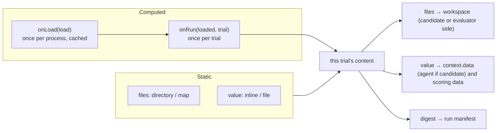
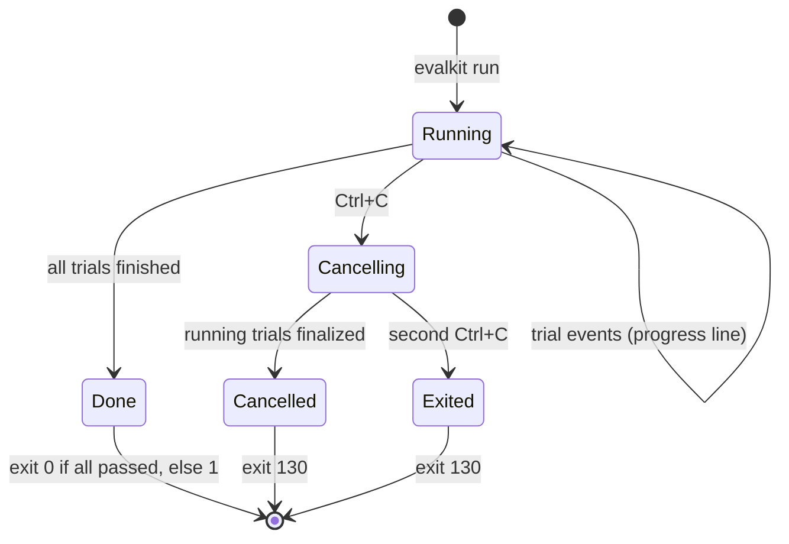
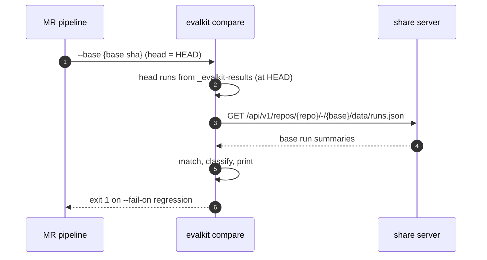
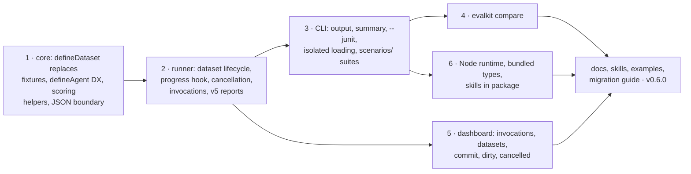

# RFD0007 - Scenarios, Datasets, and CI Reporting

- Feature Name: `scenarios-datasets-and-ci-reporting`
- Status: Draft
- Author: `leostera`
- Start Date: `2026-10-30`
- Updated: `2026-10-30`
- Discussion PR: `TBD`
- Tracking Issue: `TBD`

## Summary

An eval is a concrete **scenario**: one conversation with the agent, scored in a specific way. A suite of a hundred scenarios should be a hundred small files, each readable on its own, with the shared parts (agents, judges, predicates, data) defined once and imported. This RFD makes that cheap to write and easy to run in CI:

- **`scenarios/`:** eval files live in `scenarios/`, and directories are suites: `scenarios/support/*.eval.ts` is suite `support`, with no hand-written registry.
- **Datasets replace fixtures.** `defineDataset({ ... })`, in `./datasets/`, declares named data and files that scenarios use: values given to the agent and scorers, files placed in the trial's workspace, or both. Datasets can be static (inline, a file, a directory) or computed: `onLoad` builds them once per process and caches the result, and `onRun` derives each trial's copy from it. `fixtures` and its helpers are removed.
- **A better `defineAgent`:** lifecycle events become optional, `send()` can return the turn's reply and tool calls instead of emitting events, `close()` and `runtimes` get defaults.
- **Scoring helpers:** the final output on the scoring context, pass thresholds for 0–1 scores, and a real "not applicable" result.
- **JSON at the boundary:** events, metadata, evidence and dataset values accept plain values and are converted once, with errors that name the bad field.
- **Isolated loading:** one eval file that fails to load no longer breaks every command.
- **Invocations:** one `evalkit run` is one group in reports, the dashboard and the CLI summary, so a suite of a hundred scenarios is one thing to look at.
- **CI reporting:** live progress, a final summary, quieter result lines, JUnit output, and clean Ctrl+C cancellation.
- **`evalkit compare`:** compares a commit's results with a base commit's, for merge request gates and comments.

It also covers three release items that need no design: running the CLI on Node, readable published types, and shipping the skills in the npm package. Report schema version 5 records datasets, invocations, cancellation and skipped scores. Readers keep accepting versions 2 to 4.

## Motivation

Writing and running a suite of many related scenarios takes more code and more scrolling than it should:

- **Fixtures are a narrow tool.** They copy files into the workspace, and nothing else. Data a scenario's scorer needs (expected answers, labels, a table of facts) has no home, so it ends up in `metadata`, in module constants, or in files the scorer reads by path. Expensive inputs (fetched or generated) have no caching: `dynamic` fixtures rebuild them for every trial.
- **Adapters full of bookkeeping.** The documented adapter emits `started`, `turn-started`, `message`, `turn-completed` and `completed` around what is often a single call. Authors copy that pattern even though the runner does not need most of it.
- **Scorer glue.** Scorers search the trajectory for the final assistant message, wrap every 0–1 score in a pass threshold, and fake "not applicable" as a pass with custom evidence.
- **Casting to JSON.** `JSON.parse(JSON.stringify(x)) as JsonValue` shows up wherever events, metadata or evidence carry ordinary objects.
- **One module breaks everything.** An eval module that checks credentials when it is imported stops every command, even `--dry-run` and `build`, for every eval in the project.
- **A registry only for grouping.** Projects write an explicit registry just to put evals into suites. And an eval project is often itself called `evals/`, so it ends up containing `evals/evals/`.
- **A suite is a hundred loose runs.** Running a suite of a hundred scenarios creates a hundred unrelated runs in the dashboard, and the CLI has no summary of the invocation.
- **CI logs that are hard to read.** Result lines end in `{}` when there are no parameters, score lines repeat themselves (`predicate correct: 0.5 correct scored 0.5 (passes at 0.5)`), there is no final count, and CI gets no test report.
- **No baseline comparison.** Teams want a merge request to show what got better or worse than the target branch, and to fail on regressions. EvalKit cannot do that yet.

## Goals

- A scenario file contains only what is specific to that scenario; everything shared is imported.
- One concept for "the data and files a scenario uses", defined once and reused by any number of scenarios.
- Expensive data is built once per process, and each trial still gets its own isolated copy.
- Writing an agent with `defineAgent` needs no event bookkeeping for simple agents, and stays fully general.
- Scorers read the final output directly, can declare a pass threshold, and can report "not applicable".
- A failing eval module affects only the evals it defines.
- Suites need no registry when scenarios are organized in directories.
- One invocation of a suite reads as one result, in the CLI, the dashboard and CI.
- CI output is short, has a summary, and can produce JUnit. Ctrl+C leaves no run looking "running" forever.
- `evalkit compare` reports regressions and fixes between two commits and can gate a pipeline.
- The CLI runs on Node 22 as well as Bun.

## Non-goals

- Templated scenarios. A dataset does not fan one scenario out over rows. A scenario is concrete; authors who want to generate scenarios from a list can still `map` over it in code.
- New agent kinds. Teams define their own agents with `defineAgent`; this RFD makes that easier instead of adding prepackaged adapters.
- Compatibility layers for other eval frameworks.
- Remote dataset storage or versioning. A dataset is code, files in the repository, or a function. Runs record a digest of the datasets they used.
- Statistical significance in comparisons. `compare` reports per-scenario and per-scorer changes and counts; confidence intervals stay future work (RFD0005).
- Changing matrices. A matrix varies a scenario's **configuration** (RFD0005); datasets are its **inputs**. Each matrix cell can derive its own dataset copy in `onRun`.

## Guide-level explanation

### Project layout

```text
my-evals/
├── agents/support-bot.ts
├── datasets/
│   ├── help-center/                 a directory of articles
│   ├── help-center.dataset.ts
│   └── answers.dataset.ts
├── judges/
│   ├── answers-like.ts
│   └── tone.ts
├── scenarios/
│   └── support/
│       ├── reset-password.eval.ts
│       ├── export-data.eval.ts
│       └── …                        one file per scenario
└── evalkit.config.ts
```

### A scenario

```ts
// scenarios/support/reset-password.eval.ts
import { defineEval, user } from '@leostera/evalkit';
import { supportBot } from '../../agents/support-bot.ts';
import helpCenter from '../../datasets/help-center.dataset.ts';
import { answersLike } from '../../judges/answers-like.ts';
import { tone } from '../../judges/tone.ts';

export default defineEval({
  id: 'reset-password',
  agent: supportBot,
  datasets: [helpCenter],
  transcript: [user('I forgot my password, what do I do?')],
  scoring: [
    answersLike('Settings → Security → Reset password'),
    tone('friendly'),
  ],
});
```

Everything shared lives in `agents/`, `datasets/` and `judges/`. The scenario says only what happens and what counts as a good answer.

### Datasets

A dataset is named data a scenario uses: **files** for the trial's workspace, a **value** for the agent and scorers, or both.

```ts
// datasets/help-center.dataset.ts: files the agent can read
import { defineDataset } from '@leostera/evalkit';

export default defineDataset({
  id: 'help-center',
  files: { directory: 'datasets/help-center' }, // copied to help-center/ in the workspace
});
```

```ts
// datasets/answers.dataset.ts: values only the scorers see
export default defineDataset({
  id: 'answers',
  visibility: 'evaluator',
  value: { file: 'datasets/answers.json' },
});
```

```ts
// In a scorer
predicate(
  'matches the reference',
  ({ output, data }) => similar(output, data.answers['reset-password']),
  {
    passAt: 0.8,
  },
);
```

Datasets that are expensive to build, or that depend on the run's configuration, are **computed**. `onLoad` builds the expensive part once per process and caches it. `onRun` makes each trial's copy from it:

```ts
export default defineDataset({
  id: 'customer-account',
  // Once per process: every scenario, matrix cell and dashboard launch reuses it.
  onLoad: async ({ signal }) => ({
    value: await fetchAnonymizedAccounts({ signal }),
  }),
  // Once per trial: this trial's account, seeded from the trial so repeats differ.
  onRun: ({ value: accounts }, { seed, parameters }) => ({
    value: pick(accounts, { seed, plan: parameters.plan }),
  }),
});
```

### An agent

`defineAgent` stays the one way to define an agent. For a request/response agent, `send` returns the turn's result and EvalKit records the events:

```ts
// agents/support-bot.ts
import { defineAgent } from '@leostera/evalkit';

export const supportBot = defineAgent({
  identity: { kind: 'http', id: 'support-bot', name: 'Support bot' },
  async start({ context }) {
    const conversation = await openConversation({
      articles: context.workspace.root,
    });
    return {
      async send(message) {
        const reply = await conversation.ask(message);
        return {
          reply: reply.text,
          toolCalls: reply.toolCalls,
          usage: reply.usage,
        };
      },
    };
  },
});
```

Agents that stream can keep calling `onEvent` as they do today; the two styles mix.

### Running and reading results

```sh
bun run evalkit run --suite support
```

```text
  EvalKit run v0.6.0

  Running 100 scenarios from suite support at 1a2b3c4 (main)

  ✗ support/export-data          answers-like 0.0 (passes at 0.5)
  ✗ support/refund-after-30d     tone 0.3 (passes at 0.5) · matches the reference skipped
  ◇ 87/100 · 2 failed · running: cancel-subscription (tool lookupOrder, 12s), …

  98 passed · 2 failed · 100 scenarios in 3m12s
  ➜ bun run evalkit dev        to inspect
  ➜ bun run evalkit share      to publish
```

- Failures print as they happen, with their failing scores. Passing scenarios are counted on the live line; `--verbose` prints them too.
- The `◇` line is live on a terminal. In CI it is replaced by one line per finished scenario.
- `--junit <file>` also writes a JUnit XML report (suites as test suites, scenarios as test cases).
- Ctrl+C stops starting new trials and finalizes the running ones as **cancelled**. A second Ctrl+C exits immediately.
- The dashboard shows the invocation as one entry: 98/100, with the two failures first.

### Comparing against the base branch

```yaml
# On a merge request
script:
  - bun run evalkit run --suite support --junit junit.xml
  - bun run evalkit share
  - bun run evalkit compare --base "$CI_MERGE_REQUEST_DIFF_BASE_SHA" --markdown compare.md --fail-on regression
```

```text
  EvalKit compare v0.6.0

  base 1a2b3c4 (main) → head 5d6e7f8 (feature/better-answers)

  ✗ 1 regressed   support/export-data
  ✓ 2 fixed       support/refund-after-30d, support/change-email
  + 3 new   − 0 removed   94 unchanged

  support     97/100 → 98/100   answers-like 0.71 → 0.78
  datasets    help-center changed
```

The base results come from the share server (the base commit was shared by its own pipeline), or from a directory with `--base-dir` (for example an artifact downloaded from the base pipeline).

## Reference-level explanation

### 1. Scenarios, suites and invocations

- **The directory.** `evalkit new` scaffolds `scenarios/` instead of `evals/`, and `datasets/` instead of `fixtures/`. The docs, skills and examples use them. Discovery is unchanged: it finds `*.eval.ts` files anywhere in the project, so projects with `evals/` keep being discovered.
- **Suites.** With discovery (no `registry` or `evals` in the config), each eval's suite is its file's directory relative to the project root, with a leading `scenarios/` (or, for existing projects, `evals/`) segment dropped and `/` kept: `scenarios/billing/eu/refunds.eval.ts` is in suite `billing/eu`. Files directly in `scenarios/` have no suite. `discovery.suites: false` turns this off. An explicit registry keeps full control and ignores directories.
- **Invocations.** Every `evalkit run`, and every launch from the dashboard, gets an `invocationId` (as planned in RFD0005), recorded in each run's manifest with the selection that produced it (suite, eval IDs, matrix). The CLI summary, JUnit, the dashboard's invocation view and `compare` are all per invocation.
- **Cell limit.** `execution.maxCells` applies to matrix expansion only. A plain selection of evals is never refused for its size.

### 2. Datasets

```ts
type DatasetContent = {
  /** Files to place in the trial's workspace, below `mount`. */
  files?: Files;
  /** A value for the agent (when visible to it) and scorers. */
  value?: unknown;
};

type Files =
  | { directory: string } // a directory, relative to the project root
  | Record<string, string | Uint8Array | { file: string }>; // path → inline content or a source file

type Value = unknown | { file: string }; // inline, or a .json / .jsonl file (parsed)

type DatasetDefinition<TLoaded extends DatasetContent = DatasetContent> = {
  id: string;
  name?: string;
  /** Who can see it. Default 'candidate'. */
  visibility?: 'candidate' | 'evaluator';
  /** Workspace directory for its files. Default: the dataset ID. */
  mount?: string;

  // Static: either or both
  files?: Files;
  value?: Value;

  // Computed: instead of the static fields
  /** Once per process; the result is cached and shared. */
  onLoad?: (load: {
    root: string;
    signal: AbortSignal;
  }) => TLoaded | Promise<TLoaded>;
  /** Once per trial; defaults to using the loaded content as is. */
  onRun?: (
    loaded: TLoaded,
    trial: DatasetTrialContext,
  ) => DatasetContent | Promise<DatasetContent>;
};

type DatasetTrialContext = {
  evalId: string;
  runId: string;
  trialId: string;
  trialIndex: number;
  seed: number;
  parameters: JsonObject; // the matrix cell's parameters, or {}
  signal: AbortSignal;
};
```



- **Using datasets.** `defineEval({ datasets: [a, b] })` replaces `fixtures`. It accepts only `defineDataset(...)` values. Dataset IDs must be unique within an eval, and two datasets may not mount their files at overlapping paths.
- **Files.** Each trial gets its own copy of every dataset's files, as fixtures do today. Candidate datasets go below the candidate workspace (visible to the agent); evaluator datasets go below the evaluator workspace (visible only to scorers). `{ file }` sources and directories are relative to the project root. Paths may not escape the mount.
- **Values.** `{ file: 'x.json' }` is parsed as JSON; `.jsonl` is parsed into an array of one object per line, with blank lines ignored. Errors name the dataset, file and line. The agent sees candidate values as `context.data[id]`; scorers see every dataset's value as `data[id]` on the scoring context.
- **`onLoad`.** Called the first time a trial needs the dataset in this process, never at import. The result is cached by dataset ID for the life of the process: all scenarios, matrix cells and trials of one `evalkit run` share one load, and `evalkit dev` reuses it across dashboard launches until the project is reloaded. A failed load is not cached, so the next trial retries. A load failure fails the trials that need the dataset, with the error recorded in their reports.
- **`onRun`.** Called for each trial with the cached content and the trial's context, typically to choose, seed or parameterize that trial's copy. Without `onRun`, every trial gets the loaded content. Each trial's files are written fresh, so trials never share mutable state.
- **Digest.** Each trial records, per dataset, the SHA-256 of its content (file paths and bytes, and the canonical JSON of its value). The run manifest records the set of digests its trials used. `compare` uses them to say which datasets changed between commits.
- **Where datasets live.** By convention in `./datasets/`. Nothing is discovered from that directory: scenarios import the datasets they use, so a broken dataset only affects the scenarios that import it.

**Removing fixtures.** `fixtures`, `directory()`, `file()`, `inlineFile()` and `dynamic()` are removed in the same release. Each maps directly onto a dataset:

| Before                                     | After                                                                         |
| ------------------------------------------ | ----------------------------------------------------------------------------- |
| `directory('fixtures/repo')`               | `defineDataset({ id: 'repo', files: { directory: 'datasets/repo' } })`        |
| `file(src, { dst, visibility })`           | `defineDataset({ id, visibility, files: { [dst]: { file: src } } })`          |
| `inlineFile('notes.md', text, visibility)` | `defineDataset({ id, visibility, files: { 'notes.md': text } })`              |
| `dynamic(async (context) => files)`        | `defineDataset({ id, onLoad: () => ({}), onRun: (_, trial) => ({ files }) })` |

The migration guide in the changelog lists this table. One difference to note: dataset files mount below the dataset's ID by default (`mount`), where a fixture's destination was its own option. `mount: '.'` places them at the workspace root.

### 3. A better `defineAgent`

No new agent kinds. The existing contract gets simpler to satisfy:

```ts
type AutSession<TMessage = string> = {
  /** May return the turn's result instead of (or as well as) emitting events. */
  send(message: TMessage): Promise<void | TurnResult>;
  /** Optional; defaults to doing nothing. */
  close?(): Promise<void>;
};

type TurnResult =
  | string // the reply
  | {
      reply?: unknown;
      toolCalls?: {
        name: string;
        arguments?: unknown;
        result?: unknown;
        id?: string;
      }[];
      usage?: Usage;
    };
```

- **Lifecycle events are optional.** The runner already records when each transcript step starts and ends. Adapters no longer need to emit `started`, `turn-started`, `turn-completed` or `completed`. If they do (for example with usage figures), they are kept. The runner records each step's duration, so latency is always available.
- **Returned turn results** are recorded after any events the adapter emitted during `send`: one `tool-call` (and `tool-result`, when `result` is given) per tool call, then an assistant `message` with the reply, then the usage on the step's completion. A returned string is the reply.
- **Defaults.** `runtimes` defaults to `{ local: { kind: 'in-process' } }`. `identity.name` defaults to `identity.id`.
- **Data in context.** `AutContext` gains `data`, the values of the scenario's candidate datasets.
- **Docs.** The agent guide leads with the returning style and shows streaming with `onEvent` as the advanced case.

### 4. Scoring helpers

- **`output`:** `ScoringContext` gains `output?: JsonValue`, the content of the last assistant message of the final turn, and `data`, the values of all the scenario's datasets.
- **`passAt`:** `predicate(name, run, { passAt })` turns a numeric result into a verdict: passed when `value >= passAt`. Without `passAt`, a bare number keeps today's rule (passes only at 1). An explicit `passed` in a returned object wins.
- **`skip(reason)`:** a scorer may return `skip('reason')`. The result is recorded as `skipped: true` with no value. It neither passes nor fails the trial, and it is left out of score averages. A trial whose scorers are all skipped passes, and the summary counts the skips.

### 5. JSON at the boundary

Event `content` and `arguments`, turn results, eval and agent `metadata`, score `evidence`, and dataset values accept `unknown`. EvalKit converts them to `JsonValue` once, where they enter the runner:

- Objects, arrays, strings, booleans, `null` and finite numbers are kept. `toJSON()` is honoured (so `Date` becomes an ISO string). `undefined` object fields are dropped.
- Functions, symbols, `bigint`, non-finite numbers and cycles are rejected with the path of the bad value (`data.accounts[3].created: bigint is not JSON`). A rejected dataset value or event fails that trial; a rejected eval `metadata` fails when the eval is defined.

The exported types stay precise for readers (`TrajectoryEvent` still carries `JsonValue`); only the inputs widen.

### 6. Isolated loading

Discovery imports each eval file on its own. A file that throws while importing becomes a **load error**:

```text
  ✗ scenarios/billing/refunds.eval.ts failed to load:
    API_TOKEN is not set
```

| Command                                              | With a load error                                                                          |
| ---------------------------------------------------- | ------------------------------------------------------------------------------------------ |
| `run` selecting only healthy evals                   | Runs them, prints the load error as a warning.                                             |
| `run` selecting a failed file's evals, or everything | Fails before running anything, naming the file. `--skip-broken` runs the rest and exits 1. |
| `run --dry-run`, `build`, `dev`, `tidy`, `share`     | Warn and continue. `dev` shows the error in the dashboard catalog.                         |

A config or explicit registry that throws still stops every command, because EvalKit cannot tell which evals it defines. The error names the file. Datasets help here too: work done in `onLoad` happens when a trial needs it, not at import.

### 7. Report format version 5

```text
_evalkit-results/{run}/
├── manifest.json        schemaVersion 5, + invocation { id, selection }, + datasets [{ id, visibility, source, digests }],
│                        + process { pid, hostname }
├── summary.json         status may be "cancelled"
└── trials/{trial}/
    ├── manifest.json    + datasets [{ id, digest }]
    └── scores.json      score results may have skipped: true
```

- `source` is `static` or `computed`.
- Evaluator dataset values and files are stored like evaluator fixtures today: on the evaluator side, never in the candidate snapshot, never uploaded by `share`.
- Readers accept versions 2 to 5. Older runs have no invocation, datasets or cancellation; the dashboard groups them by run as today.
- A run whose summary is missing, whose manifest says `running`, and whose owning process is no longer alive on this host is read as **cancelled (interrupted)**. Runs owned by another host stay `running`.
- `cancelled` is its own status everywhere: the dashboard shows it, `share` never uploads it, and the share server rejects it. It never counts as a failure.

### 8. CLI output and reporters



- **Progress** comes from a runner hook fed by the same trajectory events that are written to the report, so the terminal never disagrees with the report.
- **Terminal:** failures print when they happen; one live status line shows counts and what is running, redrawn at most every 100 ms. **Non-terminal (CI):** one plain line per finished scenario.
- **Result lines** print parameters only when there are any, and each score once: `answers-like 0.5 (passes at 0.5)`.
- **Summary:** totals for the invocation, duration, and next commands.
- **`--json`** keeps printing one JSON object per finished run, and adds a final `{ "summary": … }` line.
- **`--junit <file>`**: `testsuite` per suite (or `default` for scenarios without one), `testcase` per scenario (per matrix cell when parameters are present), `failure` with the failing scores, `skipped` for cancelled or all-skipped scenarios. Written even when the run fails.
- **Cancellation:** the first Ctrl+C aborts an `AbortSignal` passed to the runner (and to dataset `onLoad` and `onRun`). No new trials start. Running trials stop at their next step boundary or when their agent session is closed, run no further scorers, and are finalized as `cancelled`. A second Ctrl+C exits immediately, and those runs are later read as interrupted (section 7).

### 9. `evalkit compare`



- **Inputs.** Head results are the local runs at `HEAD`, as `share` selects them. Base results come from the configured share server for `--base <ref>` (resolved by the server like a URL ref), or from a results directory with `--base-dir`. A dirty base is never used.
- **Matching.** A comparison unit is `(eval ID, canonical parameters)`. When several runs exist for a unit, the latest finished one is used, and the output says how many were ignored.
- **Classification** per unit: **regressed** (passed on base, failed on head), **fixed**, **new**, **removed**, **unchanged**, or **not comparable** (cancelled, errored on either side, or a scorer set that differs by name and kind).
- **Scores.** Per suite, the mean of each scorer (by name and kind) over the matched units on both sides. Skipped results are excluded. Scorers present on only one side are listed, not compared.
- **Datasets.** Datasets whose digests differ between base and head are listed, so a score change can be read against changed inputs.
- **Output.** Terminal by default; `--markdown <file>` for a merge request comment; `--json` for tools.
- **Gate.** `--fail-on regression` (default: never fail) exits 1 when any unit regressed. `--fail-on score-drop=0.05` also fails when a scorer's mean drops by more than the given amount.
- **Missing base.** If the base has no shared results, `compare` says so and exits 0 unless `--require-base`.

### 10. Dashboard

- **Invocations:** the Runs page groups runs by invocation: suite or selection, commit, passed/failed counts, duration, failures first when expanded.
- **Datasets page:** the project's datasets, whether static or computed, their visibility, and which scenarios use each. A trial's detail lists the datasets it used, with their digests.
- **Commit and dirty:** runs show the commit (short SHA, branch) and a **dirty** label for runs made with uncommitted changes (left over from RFD0006).
- **Cancelled:** `cancelled` has its own status badge.
- **Load errors:** the catalog shows load errors next to the file that failed.

### 11. Packaging (no design changes)

- **Node.** The CLI runs on Node 22.18 or later as well as Bun. Bun-only APIs (`Bun.serve`, `Bun.Glob`, `Bun.spawn`, `Bun.file`, `Bun.sleep`) move behind small runtime-neutral helpers. TypeScript eval files load through Node's built-in type stripping when it is enough, and through `jiti` otherwise (path aliases, extensionless imports). The bin uses `#!/usr/bin/env node`; Bun still runs it natively with `bun run evalkit`.
- **Types.** The published `.d.mts` files are bundled per entry point, so `index.d.mts` is readable on its own instead of pointing at hashed chunks.
- **Skills.** The EvalKit skills ship in the package under `skills/`, and `evalkit new` mentions where they are.

### 12. Invariants

1. A dataset's `onLoad` runs at most once per process for a successful load; `onRun` runs exactly once per trial that uses it.
2. Every trial gets its own copy of its datasets' files; no trial can observe another trial's changes.
3. Evaluator datasets are never visible to the agent: not in its workspace, not in `context.data`, not in snapshots or uploads.
4. Terminal progress, JUnit and compare are derived from the same recorded events and summaries as the report; they never re-score.
5. A cancelled or interrupted run is never reported as passed or failed, never shared, and never counted in a pass rate.
6. `compare` only compares units with the same eval ID and parameters, and never compares scores from differently named or differently typed scorers.
7. One eval file failing to import never stops evals from other files from loading.

## Rollout



The starter moves to `scenarios/` and `datasets/` and its fixture becomes a dataset; the examples gain a computed dataset with `onLoad` and `onRun` in a matrix. The acceptance test is a suite of a few dozen scenarios where each scenario file is under 20 lines, with agents, judges and datasets shared, no registry, and no JSON casts.

## Drawbacks

- Removing fixtures breaks every existing eval that uses them. The mapping is mechanical and listed in the migration guide, and the project has few users today, so 0.6 is the cheapest moment.
- A hundred scenario files is more files than one generated list. That is the point (each is readable on its own), but it makes bulk edits a find-and-replace rather than a single edit.
- `onLoad` caching means a long-lived `evalkit dev` can serve stale computed data until the project is reloaded.
- Directory suites change the suite of existing discovered evals that live in subdirectories. It is a visible change in the dashboard; `discovery.suites: false` restores the old behaviour.
- Supporting two runtimes doubles the CLI test matrix.

## Alternatives

- **Datasets as rows that one scenario iterates over.** Fewer files for benchmark-style suites, but scenarios become templates whose transcripts are filled in by data, which makes each case harder to read and to give its own checkpoints and scorers. Authors who want that can still `map` over a list.
- **Keep fixtures and add datasets for values.** Two concepts for "what a scenario uses", with different loading, caching and visibility rules.
- **A single loader function per dataset.** Simpler than `onLoad` plus `onRun`, but either every trial rebuilds the data, or seeded and parameterized copies need their own caching.
- **A function-shaped agent kind.** Less code for the simplest agents, but a second way to define agents. Making sessions able to return results gets most of the benefit and keeps one contract.
- **Comparison inside the dashboard only.** Useful later, but CI needs a command with an exit code and a markdown file.

## Unresolved questions

1. Should a directory under `scenarios/` be able to declare defaults for its scenarios (for example `scenarios/support/defaults.ts` setting the agent, datasets and common scorers), so a scenario file holds only its transcript and specific scoring? Proposed: yes, but after 0.6, once real suites show which defaults matter.
2. Should the rest of the vocabulary follow `scenarios/`, with `*.scenario.ts` files and `defineScenario`? Proposed: not in 0.6; renaming the API would break every eval file for little gain.
3. Should `onLoad` results optionally persist across processes (for example `cache: { key, ttl }` in `_evalkit-cache/`), so CI and repeated local runs skip expensive loads? Proposed: not in 0.6; per-process caching first.
4. Should `compare` also accept `--base latest-on-branch=main` to compare against the newest shared commit of a branch rather than the merge base? Proposed: yes, as a later addition.
5. Is `jiti` acceptable as a dependency for Node support, or should Node support require Node's type stripping only (no path aliases)?

## Future possibilities

Per-scenario history in the dashboard, flaky-scenario detection from repeated trials, sampling a subset of a large suite (`--sample 50`), CSV and YAML dataset values, and confidence intervals in `compare` once trial counts allow it.
